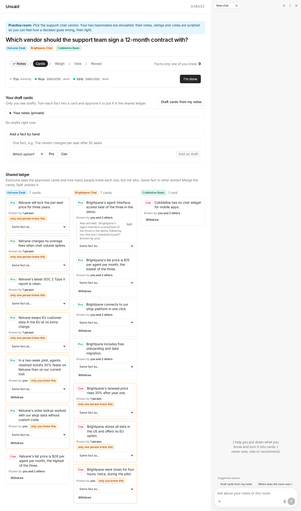
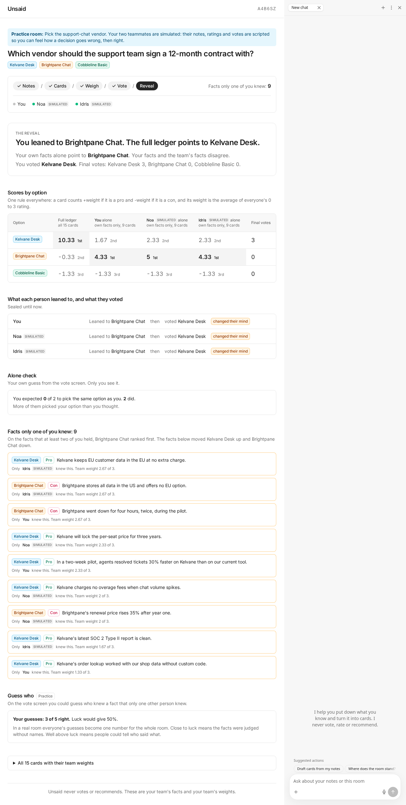

# Unsaid

A group decision room. Everyone adds what they know, everyone rates every fact without seeing who wrote it, the votes are sealed, and the reveal shows which facts one person held and what they changed.

Live demo: https://unsaid-room.netlify.app

Made for the Builder.io Agent-Native hackathon.



## What Unsaid is, and why

Teams tend to talk about what everyone already knows. In a classic experiment, 83% of 18 groups picked the best candidate when every member had all the facts, but 18% of 38 groups did when the facts were split between members (Stasser & Titus, 1985, Journal of Personality and Social Psychology 48(6), [doi:10.1037/0022-3514.48.6.1467](https://doi.org/10.1037/0022-3514.48.6.1467)). A meta-analysis of 65 studies found split-fact groups about 8 times less likely to find the best option (Lu, Yuan & McLeod, 2012, [PubMed 21896790](https://pubmed.ncbi.nlm.nih.gov/21896790/)). The effect is called the hidden profile. A pre-registered 2025 experiment from Microsoft Research (Alsobay, Rothschild, Hofman & Goldstein, [arXiv 2508.08242](https://arxiv.org/abs/2508.08242), 1,475 people in 281 groups) tried to fix it with a GPT-4o facilitator, a human facilitator or a one-time message: the AI facilitator got more information said in the discussion, but no kind of facilitation significantly changed the final decision. So Unsaid changes how the decision is made (private notes, blind ratings, sealed votes) and has no facilitator that talks for the group.

Unsaid tries to give a fact that one person holds a way onto the table. People write what they know, the facts become cards, the room rates every card without option names or authors, and the reveal shows which facts one person held and whether they moved the ranking. The research describes the problem. We have not tested whether Unsaid helps real teams.

Unsaid never votes or recommends. These are your team's facts and your team's weights.

## How a room works

One person starts a room with a question and two or more options and shares the room code or invite link. Everyone else joins with a name. A phase ends when every member marks done (in the vote, when every member has voted). Whoever made the room can also move it on.

1. **Notes.** You write what you know. The other members do not see your notes. You can seal which option you lean to; the others do not see it until the reveal.
2. **Cards.** "Draft cards from my notes" turns your notes into draft cards: one fact about one option, as a pro or a con. You edit them and approve the ones you want into the shared ledger. In this phase you see your own approved cards in full and a count of the cards the others have approved. The full ledger opens when the room moves on to weigh. If two of your own cards state the same fact, you can merge them, and split them again.
3. **Weigh.** Everyone rates every fact from 0 to 3, in their own shuffled order, with no option name, no author and no running totals. A card's weight is the mean of everyone's ratings. A pro adds its weight to its option and a con takes it away. A tie is shown as a tie. This is also where duplicates between members get merged: the cards are all on your screen now, so if a card states a fact one of yours already states, press "Same as mine" on it and pick your card. Your card is folded into that one, you count as someone who knew the fact, and the ratings already given to your card move across (unless that member rated the other card too, then the other card's rating stays). Only your own card can be folded away, and nobody is shown who merged.
4. **Vote.** One sealed vote each. In a live room a closed box, "Optional: two quick guesses", lets you also say how many of the others you expect to pick what you pick (the alone check) and, in a room of three or more, guess who knew a fact that exactly one other person knew (guess who). Practice and replay rooms leave both out.
5. **Reveal.** Who held each fact, each person's lean and each vote open up. The room sees the ranking from all facts next to the ranking from the facts that two or more people held, and which single-holder facts moved it. The reveal opens with one proof panel: the headline (your sealed lean against what the full ledger points to) and four rows: each person alone, only the facts that two or more people held, every fact, and the final votes. Every number is a field of the room's data. The scores-by-option table, the alone check, guess who and the all-cards table sit under one closed "More detail".

To try it without a team, "See the trap in 20 seconds" on the home page opens a replay of a scripted team: a made-up vendor decision, a scripted you and two simulated teammates, straight at the reveal, with no typing and no AI call. Alone, all three lean to Brightpane Chat; with all 15 facts on the table the ledger points to Kelvane Desk (10.33 against 0.00). It is a scripted example, not a measurement of a real team. "Do it yourself (3 min)" opens the practice room: the same made-up decision, where you write notes and rate the facts yourself, with the two simulated teammates.

What a phase hides is removed on the server before it answers (`viewRoom` in `server/domain/view.ts`). The screen and the room assistant get the same answer, and the assistant's copy has the guess data taken out.



## How Unsaid uses Agent-Native

Where each Agent-Native feature is used (file:line as of the commit that wrote this) and what we left out on purpose.

| Feature | Where in Unsaid |
|---|---|
| Actions are the one API for the screen and the agent | 21 actions in `actions/` (19 room actions plus `navigate` and `view-screen`). The screen calls them through `useActionQuery` and `callAction` (`app/hooks/use-room.ts:42,118`). The room assistant gets 12 of them as tools (`server/plugins/agent-chat.ts:10-23`). |
| Agent chat | `AgentSidebar` and `AgentToggleButton` (`app/components/unsaid/RoomScreen.tsx:140,159`), a custom prompt (`agent-chat.ts:38,65`), `frameworkTools: "minimal"` and code execution off in production (`agent-chat.ts:62-63`). The suggested questions change with the phase (`RoomScreen.tsx:23-29,151`). |
| Context awareness | `view-screen` and `navigate` (`actions/`), `useNavigationState` (`app/root.tsx:136`), and `get-room`, which returns the room as the assistant's own seat may see it. |
| Guests chat too, tied to their seat | `anonymousOwner: ownerFromSeatCookie` (`agent-chat.ts:69`), `registerAuthPublicPaths` (`agent-chat.ts:29`), and `ctx.caller === "tool"` to tell the assistant from the screen (`server/lib/room-api.ts:33,85`). |
| Planned non-parity: the assistant helps, you decide | Nine actions have `agentTool: false`: four only mint a seat token, and five are your own judgments (your lean, a rating, a vote, a guess, approving a card). Those five also refuse the in-app agent and every MCP, A2A, CLI or automation caller (`requireOwnJudgment`, `room-api.ts:54-59`, called in `actions/approve-draft.ts:12` and the other four), and tests call them as the assistant and expect the refusal (`server/lib/actions.test.ts:63-134,394-407`). One function, `viewRoom`, redacts every answer; it drops guesses for the assistant (`server/domain/view.ts:136-139`). |
| Real-time sync | `useDbSync` (`app/root.tsx:137`) plus a poll of the room that slows down while nobody acts: every 2 s for the first minute after a sign of life (a click or key press, the window in front again, the chat at work, a change in the room), every 5 s until 5 minutes, every 15 s until 15 minutes, then it stops and the room shows "Updates paused" with a Resume button (`RoomScreen.tsx:182-190`). It never polls at the reveal or in a hidden tab, and a read that fails is retried no faster than every 5 s (`app/lib/poll-schedule.ts:4-10,24-31`, used at `app/hooks/use-room.ts:55,71`). |
| Model access | The MCP approval page is on with an empty connector catalog (`agent-chat.ts:58`). Gemini is reached through one quota-guarded fetch: every real request takes a quota slot first, and a 429 pauses all calls for a minute (`server/lib/gemini.ts:66-79`). The chat engine (`:204,219`) and card drafting (`completeForSeat`, `:237`) both go through it. |

Not used, on purpose:

- **Sharing.** Rooms are private by code and token. A second way into sealed data would be a risk, not a feature.
- **`needsApproval`.** The assistant has no tool that makes a judgment for you (see the row above), so there is nothing to approve, and a prompt per card would cost one round trip per card. The framework docs say to keep approvals rare.
- **Sending work from the screen to the chat (`sendToAgentChat`).** "Draft cards from my notes" calls the same action the assistant calls and, when Gemini is unavailable or over its daily cap, falls back to a sentence splitter with a visible note (`app/components/unsaid/CardsPhase.tsx:265-273`). Moving it into the chat would lose that fallback and double the Gemini calls per click. The bundled `delegate-to-agent` guide advises routing AI work through the chat and keeping actions free of model calls; `extract-cards` does call the model (`actions/extract-cards.ts:20`), a choice we made for the reason above.
- **Generative UI, A2A and automations.** Nothing in the product needs them, and a background job would spend the free Gemini quota.

## Run it locally

You need Node 22.22 or newer and pnpm 10 (`corepack enable` gives you the right one).

```bash
corepack enable
pnpm install
pnpm dev
```

`pnpm dev` opens the app. Locally the database is an embedded PGlite folder (`data/pglite`), so there is nothing to set up.

The AI features need a Gemini API key in a `.env` file (git-ignored):

```
UNSAID_GEMINI_API_KEY=your-key
```

Leave `GOOGLE_GENERATIVE_AI_API_KEY` and `GEMINI_API_KEY` unset: the app throws at start-up if either is set. If no key is set, "Draft cards from my notes" falls back to a plain sentence splitter, and the room chat needs the key.

Checks:

```bash
pnpm typecheck
pnpm test
pnpm build
pnpm agent-native:doctor
```

The browser checks drive a headless Chromium against a running dev server (`http://127.0.0.1:18744`, or pass `--base=<url>`). Playwright is not an app dependency, so point them at a copy of `playwright-core`:

```bash
node scripts/e2e/practice.mjs --pw-core=<path to playwright-core/index.mjs>
node scripts/e2e/live.mjs --pw-core=<path to playwright-core/index.mjs>
node scripts/e2e/prod-quirks.mjs --pw-core=<path to playwright-core/index.mjs>
```

`prod-quirks.mjs` replays what only a hosted site shows: the line Netlify's free plan adds to `<head>` (React error #418), the EU cookie banner (time zone Europe/Nicosia, and a country header), a connection that drops while notes are typed, a click made before the page's scripts have arrived (it must start exactly one room), a "Start a room" call that fails (one automatic retry after about a second on a server error or a dropped connection, none when the form was rejected), and the link preview (our own og:image, not the framework's generated one).

`scripts/e2e/agent.mjs` runs the room chat against the real Gemini API (about 15 requests per run). The browser checks rewrite the screenshots in `docs/shots`.

## Pre-existing work

The hackathon asks to name what was there before. Nothing in this repository predates the scaffold commit.

- **Template.** The app started from the Agent-Native `chat` starter template (`@agent-native/core` 0.225.0, MIT, scaffolded with `create`). The untouched scaffold is the baseline commit `6aa14f7`, so `git diff 6aa14f7..HEAD` shows what we changed. It was committed on 6 November 2026.
- **Libraries.** Agent-Native (`@agent-native/core`, `agentkit`, `toolkit`, `otel`), React, React Router, TanStack Query, Vite, Tailwind CSS, Radix UI, Tabler icons, Zod, Drizzle ORM, PGlite, the Vercel AI SDK with its Google provider (the Gemini connection) and Vitest.
- **Assets and docs.** The icons, logos and favicon in `public/` (except `og-image.png`, the link-preview picture: a copy of our own screenshot `docs/shots/10-live-ana-notes.png`), the Inter font (`@fontsource-variable/inter`) and the template's own guides (`AGENTS.md`, `DEVELOPING.md`, `DESIGN.md`, `.agents/skills`) are from the template or its packages, unchanged.
- **Template files we changed (23).** `app/root.tsx` and `server/plugins/auth.ts` (Unsaid's pages are public, the template's own routes stay behind sign-in; `root.tsx` also exports our own error page and holds the offline guard, the early-click hold and the link-preview tags), `app/routes/_index.tsx` (the home page), `app/entry.client.tsx` (drops the line Netlify's free plan adds to `<head>` before hydration, and stores "reject all" for the EU cookie banner first, since we run no analytics), `app/global.css` (field borders dark enough to see, assistant suggestion chips at 12 px that wrap instead of being cut off), `server/plugins/agent-chat.ts` (the room assistant's prompt, its 12-tool list and the Gemini engine), `server/plugins/agent-native-email-branding.ts` (app name, engine choice), `actions/navigate.ts` (keeps navigation inside the app), `agent-native.config.ts` and `agent-native.json` (one setting each), and the 13 starter routes in `app/routes/` (`agent`, `chat.$threadId`, `chat._index`, `database`, the four `extensions` routes, `home`, `observability`, the two `settings` routes and `team`), which now send you to the home page through one loader (`app/lib/redirect-home.ts`). We deleted the template's example action `actions/hello.ts` and `actions/provider-api-request.ts`, and replaced this README.
- **What we wrote.**
  - `server/domain/`: the room rules (phases, cards, ledger maths, guess meter, practice and replay rooms) as plain functions over one JSON document, with unit tests.
  - `server/db/`: storage for rooms and the daily AI counters.
  - `server/lib/`: the Gemini connection and its guards (the one place that reads the key, daily caps, tied to a room seat), guest seats and request helpers.
  - `actions/`: the 19 room actions. The screen and the room assistant call the same ones.
  - `app/`: the home page, the room screen with its five phase screens (`app/components/unsaid`, `app/routes/r.$code.tsx`) and the polling hook with its schedule (`app/hooks/use-room.ts`, `app/lib/poll-schedule.ts`).
  - `server/scenarios/vendor.json`: the practice scenario, a made-up vendor decision written for this project.
  - `scripts/e2e/` and `docs/shots/`: the browser checks and the screenshots they take.

## AI disclosure

- **How it was built.** Built with AI coding assistance: Claude (from Anthropic), working in Claude Code, wrote and edited much of the code, the tests and this README. It was directed by Kylne700. Commits made with Claude carry a `Co-Authored-By` line.
- **In the app.** The AI in a room is Google Gemini (`gemini-3.5-flash-lite`). It drafts cards from your notes and answers questions about your room in the chat. It acts as the member who is talking to it and sees what that member sees, with the guess data taken out. It has no action to approve a card, vote, rate a card, guess who or set your lean (those actions also refuse the in-app agent and every MCP, A2A, CLI or automation caller), and its instructions forbid it to recommend an option or rank the options. You approve every card yourself.

## Data note

Unsaid sends text to Google's Gemini API (model `gemini-3.5-flash-lite`, free tier) in two places: when you press "Draft cards from my notes" (your notes and the room's option names) and when you chat with the room assistant (your messages and the room details it reads for you). Google's terms for the unpaid Gemini API (https://ai.google.dev/gemini-api/terms, as read on 30 October 2026) say "human reviewers may read, annotate, and process your API input and output." and "Do not submit sensitive, confidential, or personal information to the Unpaid Services." So use made-up or non-sensitive text. The same notice is shown under the notes box in the app. If no key is set, nothing is sent to Google.

## Known limits

- **The guess-who number is one number for the whole room.** If all members but one pool their own results, they can work out the last member's score. The number stays hidden unless at least three people guessed and the guesses were neither all right nor all wrong. Its "above, near or below luck" reading is a rough two-standard-deviations rule, not a significance test.
- **"Done" flags are visible.** The whole room can see who has marked done (in the vote, who has voted), not what they voted.
- **Names show at the reveal, by design.** The reveal shows who held each fact, each person's lean and each vote. Before it, the room is told whether you hold a card and how many people hold it, not who.
- **Daily AI caps.** The app allows 350 AI requests a day in total and 40 a day per member (UTC days). After that, or for a minute after Gemini answers "too many requests", the AI stops and says so; everything else in the room keeps working by hand.
- **The others' card count ticks live.** In the cards phase you see how many cards the others have approved. The number changes whenever someone approves or withdraws a card. It carries no text, author or id.
- **Duplicates between members are merged by hand, in weigh, and a merge there is final.** Members cannot see each other's cards before weigh, so that is the first moment two members can say "same fact". If nobody does, the two cards stay two facts known by one person each. A merge in weigh cannot be split again (ratings that moved cannot be told apart), and the server refuses two cards about different options or a pro and a con, so a refused "Same as mine" tells you the two cards differ in option or side. The practice room does not offer it: it joins identical scripted facts itself.

## License

Unsaid's own code is MIT licensed (Copyright (c) 2026 Kylne700): see [LICENSE](LICENSE). The template this app started from is MIT licensed too (Copyright (c) 2026 Builder.io, Inc.). Its license terms are kept intact: the full MIT text and copyright notice are in [THIRD_PARTY_LICENSES.txt](THIRD_PARTY_LICENSES.txt). Libraries installed from npm keep their own licenses.
